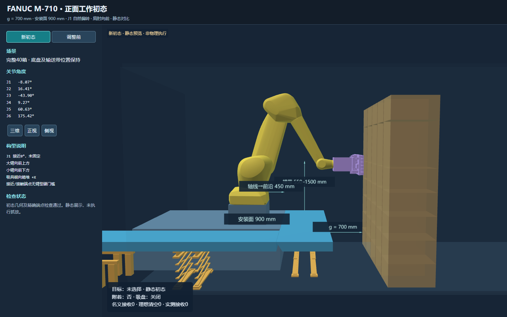

# g700：朝向箱堆的新初态及持续卸箱记录

初态让肩肘朝向箱堆，并将 J1 接近0°作为软偏好。J1 不锁定，不要求大臂严格竖直或小臂严格水平；这些方向筛选只用于选择静态初态，不作为后续正吸接近、接触端点的门槛。

## 本次修改

- `prepare_m710_gap_home.py` 默认使用 `front-working`；显式 `pose` 和 `stack-facing-upright` 历史入口保留。
- 单一初态吸盘接触参考点 `[-0.2,0,1.5]` m，吸具工作法向 +X。64个固定种子数值初值及有界等价关节配置用于选择合法初态，不改变任何箱子的业务抓取位姿。
- 新初态关节角（度）：`[-8.073748, 16.405398, -43.902968, 9.274872, 60.63386, 175.421311]`。J1 为 **-8.074°**。大臂向前上方、小臂向前下方。
- 保留关节限制、初态几何、吸具朝向、雅可比条件数及 Pinocchio/Coal 精确端点检查。缺少精确后端时默认以退出码2拒绝接受；只有显式 `--preview-only` 能输出清晰标为未接受的静态预览。
- 静态查看器提供新旧姿态对比；按钮切换不是机器人过渡轨迹，`execution_ready=false`。
- g=700 mm、安装面900 mm、基座 `[-1.85,0.15,0.90]` m、横带550～1500 mm保持固定。`--front-arm-posture none`；正吸端点臂型硬门槛及抬臂软偏好均关闭。

## 已复核结果

封存复核时间：**2026-11-10T14:04:04+08:00**。快照 `/gap-search-20261110/front-publication-t0024-c03` 包含 **24次已封存尝试**。

完整连续分支通过独立复核 **3/40箱**，剩余 **37箱**。完整40箱重新开始、历史完成0、无假定移除；初态与三维查看器的已检查关节完全一致。此快照不代表已卸完40箱，也不能用于宣称最佳固定间距或成功率。

| 箱子 | 尝试号 | 规划耗时 s | 机器人轨迹时长 s |
| --- | --- | --- | --- |
| carton_l07_c01 | 1 | 101.069 | 42.918 |
| carton_l07_c04 | 4 | 78.330 | 46.276 |
| carton_l07_c00 | 7 | 81.929 | 56.587 |

累计搜索耗时（含失败）为 8739.571 s。后台继续运行；快照时正在尝试 `carton_l07_c02`，尚未结束的尝试不计入完成或失败次数。完整累计成本、每个父状态、未搜索候选/数值轮次和失败原生调用摘要保存在 `report.json`。

`l07_c02`、`l07_c03` 仍未卸下。部分尝试已完成接触段，但未在本次数值访问时限内找到完整接收区域路径；较早的 `l07_c03` 尝试也有接触阶段超时。失败仍保留原箱体作为后续障碍，不证明全局不可达。最高剩余层优先规则仍生效，未声称已搜索全部下层箱子。

本轮为 **原生规划＋名义下落/接收＋理想出料**，`physical_execution=NOT_RUN`。箱外地面支撑未验证，离散碰撞检查不等于连续扫掠证明；没有 Isaac 动力学或机器资格结论。真实原生轨迹、父阶段身份、同箱附着/释放语义、全箱越过 X=-3.2 m 后计数均经独立检查。

## 逐次尝试

| 尝试号 | 箱子 | 结果/原因 | 耗时 s |
| --- | --- | --- | --- |
| 0 | carton_l07_c02 | RECEIVER_REGION_SEARCH_INCOMPLETE | 416.206 |
| 1 | carton_l07_c01 | 完整循环 | 101.069 |
| 2 | carton_l07_c02 | RECEIVER_REGION_SEARCH_INCOMPLETE | 394.891 |
| 3 | carton_l07_c03 | MoveItUnavailable | 396.916 |
| 4 | carton_l07_c04 | 完整循环 | 78.330 |
| 5 | carton_l07_c02 | RECEIVER_REGION_SEARCH_INCOMPLETE | 407.807 |
| 6 | carton_l07_c03 | RECEIVER_REGION_SEARCH_INCOMPLETE | 411.817 |
| 7 | carton_l07_c00 | 完整循环 | 81.929 |
| 8 | carton_l07_c02 | SINGLE_TARGET_STAGE_BUDGET_EXHAUSTED | 404.639 |
| 9 | carton_l07_c03 | RECEIVER_REGION_SEARCH_INCOMPLETE | 425.327 |
| 10 | carton_l07_c02 | RECEIVER_REGION_SEARCH_INCOMPLETE | 406.703 |
| 11 | carton_l07_c03 | RECEIVER_REGION_SEARCH_INCOMPLETE | 405.221 |
| 12 | carton_l07_c02 | RECEIVER_REGION_SEARCH_INCOMPLETE | 395.619 |
| 13 | carton_l07_c03 | RECEIVER_REGION_SEARCH_INCOMPLETE | 411.590 |
| 14 | carton_l07_c02 | MoveItUnavailable | 385.861 |
| 15 | carton_l07_c03 | MoveItUnavailable | 398.648 |
| 16 | carton_l07_c02 | RECEIVER_REGION_SEARCH_INCOMPLETE | 394.826 |
| 17 | carton_l07_c03 | RECEIVER_REGION_SEARCH_INCOMPLETE | 407.912 |
| 18 | carton_l07_c02 | MoveItUnavailable | 383.823 |
| 19 | carton_l07_c03 | RECEIVER_REGION_SEARCH_INCOMPLETE | 407.999 |
| 20 | carton_l07_c02 | RECEIVER_REGION_SEARCH_INCOMPLETE | 395.904 |
| 21 | carton_l07_c03 | RECEIVER_REGION_SEARCH_INCOMPLETE | 411.746 |
| 22 | carton_l07_c02 | RECEIVER_REGION_SEARCH_INCOMPLETE | 399.230 |
| 23 | carton_l07_c03 | RECEIVER_REGION_SEARCH_INCOMPLETE | 414.363 |

## 验证与复现

- 16项初态/姿态策略针对性测试在服务器通过（0.715 s）；推送前本地再次通过16项（0.32 s）。正式初态生成及精确检查通过（8.654 s）。实际命令和退出码见 `front-initial-tests.exit.json`、`front-initial-check.exit.json`。
- 静态查看器核验40个箱体身份、新旧姿态切换和官方FK；本次连续回放各段的FK、计数和非物理执行标签核验见 `replay.visual-qa.json`。
- 原始运行父提交 `e29a9aad7e931aa999b62865f91f4642832d4787` 加本次代码；服务器运行源码 `/work-gap-20261110-front-v1`。
- 578文件运行源码清单 SHA256：`2bf67c3fad2161e7598c3913795378d0e5a29b44f66aed1770dc561e59719035`；原生worker SHA256：`fd64e6a601c4e61c984a4f31dcb1bb58193395f5c53da169ff645bedb8df2734`。
- 布局指纹 `9e3a41389c49eed3075293613c55b0e784b53051842c769772e4ff78b64ec4d9`；已接受初态文件 SHA256 `a6f03d5256c1d72db740d0bd1409d47679a5c311fcd5545fe8af8b145601e697`；检查点 SHA256 `ec31ff8c4633503e50b682d0b14a1f60cee59939c2e386fca7fb3ecda4ad99fe`。
- 发布源码与运行源码仅有一处已说明的语义差异：静态导出器将“初态接受”与“执行准备好”分开标注，不参与规划。差异见 `runtime-to-publication.patch`，逐文件核对摘要见 `source-check.json`。复现旧字节时在单独检出目录反向应用该补丁，再用已有 `docs/experiments/m710_fixed_gap_search_20261107/restore_manifest_line_endings.py` 对运行清单恢复经过哈希验证的行尾。
- 实际卸箱命令见 `front-working-search-launch.json`：seed71109，trial600 s、prefix/stage360 s、connection30 s、OMPL20 s、max-rounds3、max-trials120。失败成本、有限候选和预算保持；没有在推送时重启或重置正在运行的搜索。

原始归档留在服务器 `/gap-search-20261110/g0700-front-working`。连续三维回放位于 `/gap-search-20261110/front-publication-t0024-c03/replay.html`；本目录只提交代码对应的报告、核验记录、哈希和截图。后台后续进展不会自动改变本次封存报告。
