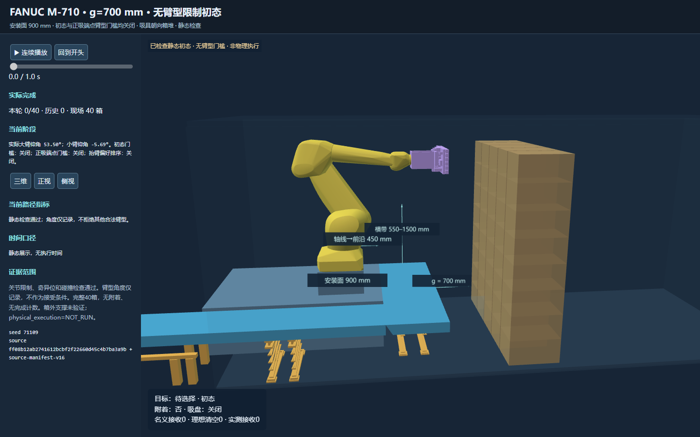

# g700：取消初态及正吸端点的臂型限制

按用户指令同时取消“大臂竖起、小臂接近水平”作为初态条件和所有正吸接近/接触端点的硬门槛。本轮显式使用 `--front-arm-posture none`，并关闭抬大臂的软偏好排序。保留 g=700 mm、安装高度900 mm、横带550～1500 mm以及吸具初始朝向箱堆的独立要求。

## 实现及实际生效证据

- `none` 成为普通 gap 搜索和初态准备入口的新默认值。`legacy-soft` 和 `upright` 仅作为显式历史模式保留；旧检查点不能静默切换模式。
- 初态臂型门槛：关闭；正吸接近/接触端点臂型门槛：关闭；抬臂软偏好：关闭。每次尝试的 `dispatch.json` 及接受计划记录三项布尔值。
- 碰撞、关节限制、奇异位、FK、吸盘密封环、附着、下落、撤离和出料检查保持原流程。没有恢复机器人/底盘或工具/底盘豁免。
- 新初态由本次静态数值IK产生，无历史解输入。实际大臂仰角 **53.504°**、小臂仰角 **-5.690°**。旧初态臂型判据测量为 false，但不再参与接受；完整初态检查通过。
- 101项针对性测试通过（4.87 s）。浏览器核验40箱、0历史完成数、实际关节与官方FK一致。封存原生尝试及成功循环的开关审核见 `g0700-none-posture-flags-audit.json`。

## 原生运行结果快照

核验时间：2026-11-09T21:10:46+08:00。运行目录 `/gap-search-20261109/g0700-no-arm-posture`，冻结审核快照 `/gap-search-20261109/g0700-none-baseline-reviewed`。

本快照包含 2 次已封存尝试。完整已接受分支独立核验 **1/40**，剩余 **39** 箱。初始40箱、历史完成0、无假定移除。尝试失败、累计耗时及未搜索项均保留；后台后续搜索不会自动更新此封存报告。

| 尝试号 | 箱子 | 完整循环 | 结果 | 耗时 s |
| --- | --- | --- | --- | --- |
| 0 | carton_l07_c02 | False | NUMERICAL_SEARCH_DEADLINE_NOT_UNREACHABLE | 427.167 |
| 1 | carton_l07_c01 | True | COMPLETE_CYCLE | 99.687 |

首轮 `l07_c02` 失败摘要：`{"reason": "RECEIVER_REGION_SEARCH_INCOMPLETE", "scope": "FRONT_TEMPLATE_ONLY", "termination": "LOCAL_NUMERICAL_VISIT_DEADLINE_NOT_UNREACHABLE", "samples_attempted": 27, "global_unreachable": false}`。取消臂型门槛后，该次仍在有限接收区域搜索中用尽数值访问时间；并非臂型门槛拒绝，也不证明全局不可达。

接触路径成功不计为卸箱完成；有限数值失败不代表全局不可达。本轮仍采用原生规划、名义下落和理想出料，`physical_execution=NOT_RUN`；箱外地面支撑仍未验证。

## 可复现身份

- 代码父提交：`ff08b12ab2741612bcbf2f22660d45c4b7ba3a9b`；运行源码 `/work-gap-20261109-v16`。
- 574文件源码清单 SHA256：`e9e132303d34f553dc43930997409ef04fdf94d6cd75b7ba8018b02e5a55a950`。提交内容与清单逐文件核对一致；Git行尾差异可用已有 `restore_manifest_line_endings.py` 哈希验证并还原。
- 原生worker仍为v2，SHA256 `fd64e6a601c4e61c984a4f31dcb1bb58193395f5c53da169ff645bedb8df2734`。
- 布局指纹：`9e3a41389c49eed3075293613c55b0e784b53051842c769772e4ff78b64ec4d9`；基座 `[-1.85,0.15,0.90]` m，固定站位。
- 实际命令见 `launch-g0700-v16.json`。保留seed71109、trial600 s、prefix/stage360 s、connection30 s、OMPL20 s、max-rounds3、max-trials120的有限资源设置。

旧 upright 运行独立保留：51次尝试、1/40，在磁盘保护阈值下完成试验边界保存。本次未导入其接受前缀。为提供新运行空间，1360个内容哈希相同的只读模型/资源副本合并为硬链接，释放约1.27 GB；所有原路径及字节保留，没有删除运行证据。新守护继续在空闲低于1200 MiB时于尝试边界保存检查点。

开发中v15有一次历史恢复测试未显式指定旧模式而失败；已保留该日志，并在v16加入“默认none不能静默恢复旧模式”的回归检查后通过全部101项测试。v15没有启动原生卸箱。

原始归档仍留服务器。此目录只发布代码对应的小型报告、检查记录和截图；初态查看器在服务器 `/gap-search-20261109/g0700-none-checked-initial.html`。
