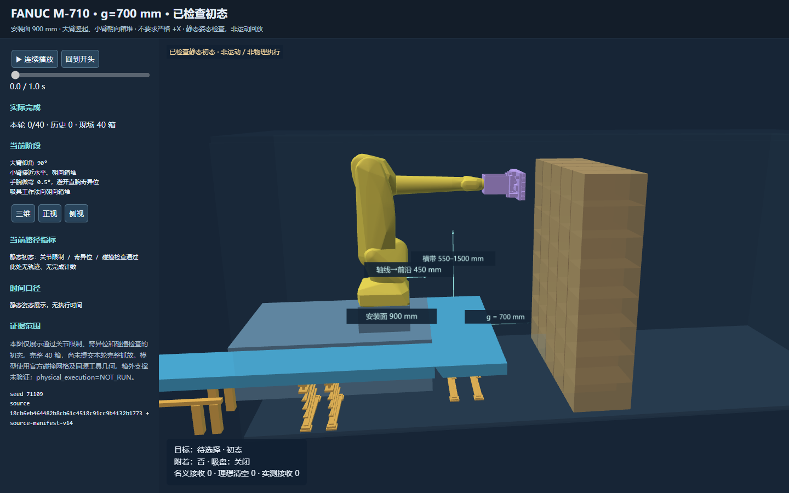

# g=700 mm：大臂竖起、小臂朝向箱堆

本轮按用户修正采用“小臂朝向箱堆即可”，没有加入严格 +X 对齐门限。间距改为 **700 mm**，沿用 **900 mm 安装面高度**。使用完整官方 FANUC 机器人和原工具几何。初始完整 **40 箱**；不导入 g=800 mm 轮次的完成数、轨迹或规划树。



## 修改与初态检查

- `tools/prepare_m710_gap_home.py` 新增 `--home-definition stack-facing-upright`，定义一个确定的静态初态候选，仍执行原有完整碰撞、关节限制、奇异位和吸具朝向检查。
- 初态关节为 `[π, 0, π, 0, 0.008726646259971648, 0]` rad；大臂仰角 90°，小臂接近水平并指向箱堆。数值上这一候选的小臂沿 +X，但 +X 精确对齐不是接受条件。
- 手腕保留 0.5° 微弯，吸具法向与朝箱堆方向偏差 0.5°，在既有 1° 容差内。最初直腕 q5=0 候选被既有奇异位检查拒绝，证据保留在 `g0700-forearm-x-home.json`；未计运动或成功。
- 基座世界坐标 `[-1.85, 0.15, 0.9]` m；底盘变换 `[-2.45, 0.35, 0]` m；台座高度 0.3 m，轴线至底盘前沿 0.45 m。冻结配置为 `configs/workcells/gap-search-206f7dc240e961da.yaml`。
- 服务器针对性测试 **36 passed in 4.19s**。静态全检查通过。HTML 浏览器复核 40 个箱体、零完成数，显示 FK 与服务器 FK 最大矩阵误差为 0。

## 实际运行与首次封存结果

首次核验时间：**2026-11-09T14:18:40+08:00**。冻结快照为 `/gap-search-20261109/g0700-first-reviewed`，主运行目录 `/gap-search-20261109/g0700-stack-facing-upright` 继续搜索。

首条已封存尝试：`carton_l07_c02`，`complete=False`，类别 `NUMERICAL_SEARCH_DEADLINE_NOT_UNREACHABLE`，耗时 429.976 s。原生请求中有 8 条接触阶段路径成功返回（`contact_complete=true`），但抽离阶段 151 次返回 `NO_IK_SOLUTION`；接收区域有限数值搜索尝试了 16 个局部采样，最终返回 `RECEIVER_REGION_SEARCH_INCOMPLETE`。这些接触路径不计为卸箱完成。独立核验当前已接受分支 **0/40**，剩余 **40** 箱。具体求解器返回、阶段与未搜索数量见 `g0700-first-report.json`。失败只说明该次有限尝试未通过，不代表全局不可达；这也不是“最佳间距”的结论。

这份结果是封存时点快照，不自动更新后台后续结果。旧 g=800 mm 运行在试验边界停止，所有历史归档独立保留。当前采用原生运动规划、名义下落及理想出料；`physical_execution=NOT_RUN`，未运行 Isaac 动力学。箱外地面支撑仍未验证；单箱完成计数不能替代完整工程验收。

## 运行身份与复现

- 源码父提交：`18cb6eb464482b8cb61c4518c91cc9b4132b1773`；冻结服务器源码目录 `/work-gap-20261109-v14`。
- 清单：`source-manifest-v14.json`，覆盖 574 个源文件/配置；SHA256 `ff10878301cff355f8479a5477e788e17d7e182a00ccfe1dbc230adf70a7ef64`。源码内容检查见 `source-check.json`。清单的 `changes` 相对服务器 v11，而不是父提交。
- 布局指纹：`9e3a41389c49eed3075293613c55b0e784b53051842c769772e4ff78b64ec4d9`。
- 原生 worker：`/gap-search-build-v2/m710_moveit_worker`，SHA256 `fd64e6a601c4e61c984a4f31dcb1bb58193395f5c53da169ff645bedb8df2734`；保持 MoveIt 2 / Pilz / OMPL 既有版本与有限预算。
- 实际启动参数完整记录于 `launch-g0700-v14.json`：seed=71109，max-trials=120，trial=600 s、prefix/stage=360 s、connection=30 s、OMPL=20 s、max-rounds=3；本轮没有 `--resume`。有限候选、未搜索项和失败代价均保留。
- 磁盘守护在空闲低于 1200 MiB 时写停止标记，于试验边界保存检查点；不删除原始证据。
- 新检出目录若仅行尾与冻结清单不同，可使用已有 `docs/experiments/m710_fixed_gap_search_20261107/restore_manifest_line_endings.py` 验证，并仅还原哈希确认的 LF/CRLF 差异。

```sh
PYTHONPATH=src:tools:tests /opt/planning-venv/bin/python tools/prepare_m710_gap_home.py \
  --gap .7 --mount-height .9 --home-definition stack-facing-upright \
  --front-arm-posture upright --seed 71109 --output /new-output/g0700-home.json
```

服务器完整初态查看器：`/gap-search-20261109/g0700-checked-initial.html`。仅小型报告和截图进入仓库；原始运行归档留在服务器。
