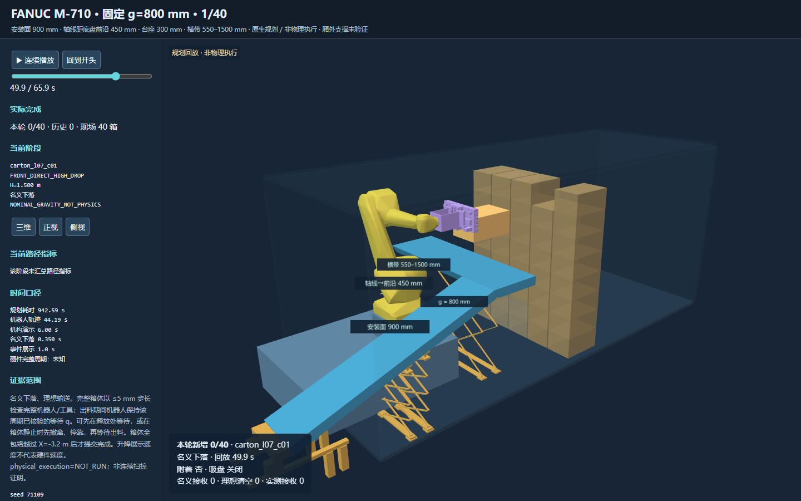
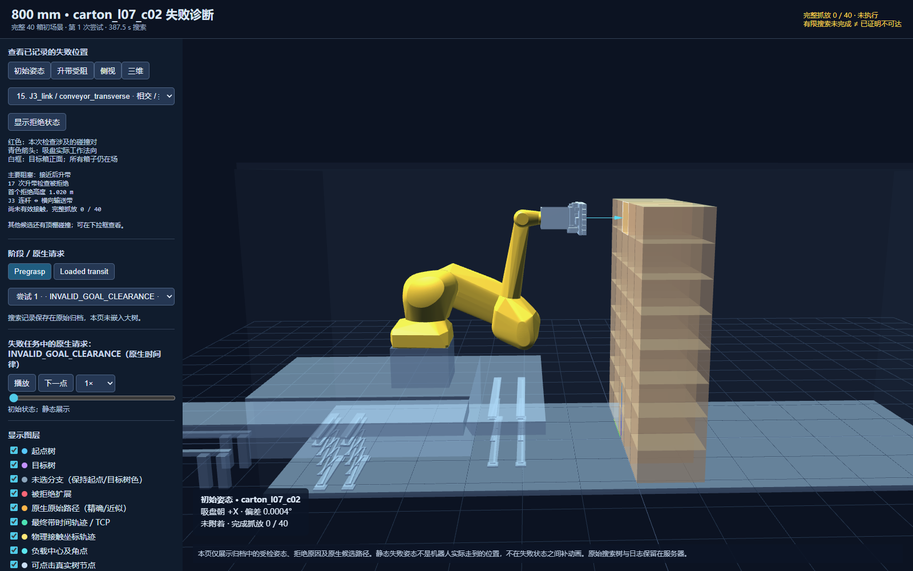
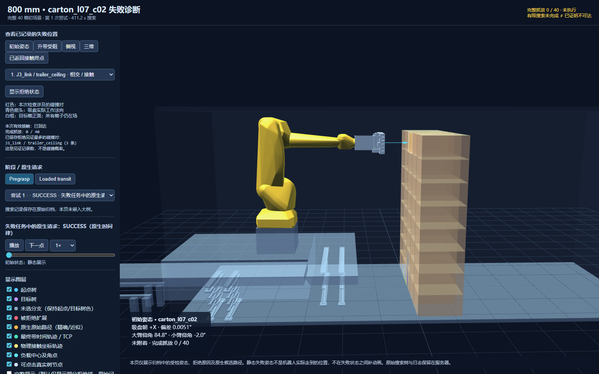
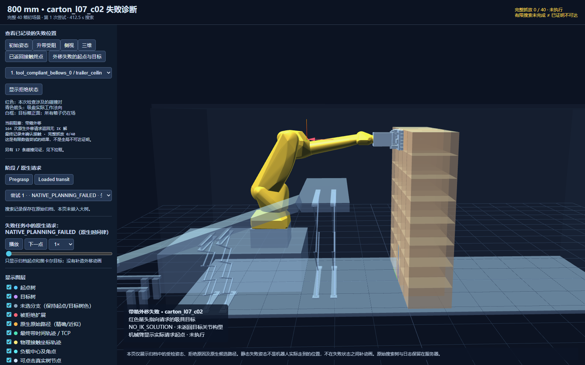

# 固定站位竖臂正吸重试（2026-11-09）

本轮从完整原始 40 箱独立场景重试，保留所有失败和成本。此前 g=200 mm 的 3/40 样本不能支持“最佳固定间距”的结论；历史移动基座成功和旧世界完成数均不计入本轮。当前新一轮单一分支独立复核完成数为 **1/40**，不宣称最佳距离或全局不可达。最新已复核结果见 [continuation-result.json](continuation-result.json)，早期失败、源码身份和未访问轮次见 [result.json](result.json)。

## 同一场景续跑更新

截至 2026-11-09T13:00:29.599267+08:00，900 mm 安装高度、g=800 mm 的同一父链独立复核为 **1/40**，剩余 **39** 箱。原始 40 箱身份不变，没有假定移走箱体，没有导入历史完成数。源代码和 worker 仍为 v11 / v2。详情及档案哈希见 [continuation-result.json](continuation-result.json)。

| 尝试编号 | 目标 | 本次结果 | 求解耗时 s |
|---:|---|---|---:|
| 0 | `carton_l07_c02` | RECEIVER_REGION_SEARCH_INCOMPLETE | 439.79 |
| 1 | `carton_l07_c03` | SINGLE_TARGET_STAGE_BUDGET_EXHAUSTED | 410.86 |
| 2 | `carton_l07_c01` | 完整周期通过 | 89.49 |
| 3 | `carton_l07_c02` | SINGLE_TARGET_STAGE_BUDGET_EXHAUSTED | 393.85 |
| 4 | `carton_l07_c03` | SINGLE_TARGET_STAGE_BUDGET_EXHAUSTED | 388.05 |

`l07_c01` 在编号 2 的尝试中完成了原生接近、升带、接触、带箱外移、名义下落、理想出料与撤离。独立复核检查了 7 个阶段和 587 个出料采样；箱体全包络越过固定 X=-3.2 m 才提交完成。横带接收高度 1.500 m，实际名义落差约 0.600 m，名义自由落体时间约 0.350 s。原生机器人轨迹合计约 44.193 s；升带展示速度和理想输送时间不作为硬件整周期测量。

初态实际连杆仰角为大臂 85.7766°、小臂 3.4112°，吸具朝 +X 箱堆方向。原生成功周期、失败请求与完成数分别记录；接触路径成功不等于完整卸箱成功。1 箱或少量箱成功不能证明 g=800 mm 是最佳固定间距。

卸下 `l07_c01` 后，编号 3 的 `l07_c02` 重试返回过 2 条成功接触路径，但 44 次外移请求返回 `NO_IK_SOLUTION`；其他接近尝试包含 11 次 `INVALID_MOTION_PLAN` 和 21 次 `TIMED_OUT`，最终耗尽该次数值预算。900 mm 下仍有腕部、工具与顶棚的搜索碰撞见证，均被拒绝，不能认为降低 100 mm 已消除所有姿态的碰顶问题。实际关节分支替换为 0；详情见 [该次请求汇总](continuation-c02-review.json)。



该图及 [浏览器检查](upright900-accepted-visual-qa.json) 对应首个已接受周期的独立快照，初态 40 箱、末态 39 箱。完整交互回放位于服务器及本地 `outputs/gap-search-20261109/upright900-accepted-review.html`。所有原始证据包仍在服务器。

已配置从本批检查点继续原队列，最多追加 120 次有限数值尝试，保留原有每阶段/每请求预算、3 轮候选访问及累计成本；详见 [续跑命令](continuation-extended-launch.json)。这是未完成搜索，不能提前计入后续箱数。空间守护会在剩余空间不足 1200 MiB 时请求于试验边界保存并停止。

本轮仍是原生规划与名义接收/理想出料；`physical_execution=NOT_RUN`。厢外支撑仍为未验证，未声明物理接收或结构资格。

下文三项独立试验及 `result.json` 保留首次续跑前的早期失败快照（60 条试验记录，0/40），与本节的新结果按时间区分。

## 构型问题与修改

之前把 J2 较大当成大臂抬起的依据，判断方向反了。官方模型中，先前 g=800 mm / TCP=[-0.4,0,2.25] m 的初态实际上大臂仰角约 -24.68°，小臂约 80.44°。仅保证吸盘朝向 +X、关节合法和无碰撞，并不能选出用户要求的整臂构型；原有软偏好也不是构型验收条件。

新显式 `--front-arm-posture upright` 模式以官方结构关节原点的世界 FK 判断：大臂 J2→J3，小臂 J4→J5。初态大臂仰角至少 75°、小臂与水平夹角不超过 20°；正吸接近及接触终点保持大臂竖向分量占优（仰角至少 45°）、小臂与水平夹角不超过 30°并向 +X 前伸。端点允许为够到固定接触点而倾斜，不把整个动作说成精确 90°/0°。保留历史 `legacy-soft` 入口语义。

1000 mm 安装面找到的合法初态为大臂 **84.8245°**、小臂 **-1.9956°**；到达接触时约 **59.1° / 4.8°**。这条分支通过了横带由 600 mm 升到 1500 mm 的检查，原先 J3/横带在 H=1020 mm 的阻塞不再出现。它仍未完成带箱外移。

900 mm 试验又暴露出另一个数值流程问题：两个前向肩部关节目标在 PTP 失败后，被 pose-only LIN 换回已外移失败的后向肩部分支（请求 q2≈0.07065，返回 q2≈-0.41184），使 RRT 没有真正连接那两个关节目标。v11 在显式 upright 模式中保留选中的关节目标，使用原生 PTP/RRT，关闭这个空载接近 pose-LIN 替换；仍检查实际返回终点，不改上游接触姿态、碰撞接受规则或共享绝对预算。其余入口保持原有方法。

同一吸具初始位置下的构型对照：





900 mm 试验中已记录的外移请求。红色箭头是吸具请求目标，机械臂保留原始请求起点：



## 实际服务器结果

下列计数是同一 `carton_l07_c02` 的数值重试次数，**不是成功卸下的箱数**。原生接触路径返回与最终尝试的 `contact_complete` 字段分别保留；900 mm v9 最后一次重试超时，其最终字段为 false，但原始请求中有 8 条成功返回的接触路径，不能据单个末次字段抹去已发生的搜索工作。

| 独立完整 40 箱试验 | 安装面 mm | 返回接触路径数 | 600→1500 mm 升带通过数 | 外移 NO_IK_SOLUTION 请求数 | 完整周期 | 尝试耗时 s |
|---|---:|---:|---:|---:|---:|---:|
| `g0800-upright1000` | 1000 | 8 | 8 | 171 | 0/40 | 411.22 |
| `g0800-upright0900-native2` | 900 | 8 | 8 | 164 | 0/40 | 412.55 |
| `g0800-upright0900-joint-goal` | 900 | 7 | 7 | 165 | 0/40 | 439.79 |

v7 的首个 900 mm 启动另保留为集成错误：原生后端尚固定 1000 mm，返回 `GAP_FIXED_LAYOUT_CONTRACT`，11.1073 s，运动规划尚未开始。它在历史原始记录中被入口粗分类为有限搜索未完成；本报告明确归为配置接入错误，不作为运动学不可达证据。v9 已同步修正 CPU 和 C++ 校验，并增加原生 1000/900 mm、台座实体及篡改拒绝测试；后续使用新二进制重新开始独立完整场景。

距离 g=800 mm、机械臂 XY=[-1.95,0.15] m 固定。用户新授权的 900 mm 安装面对应实心台座高 300 mm；1000 mm 对应 400 mm。底盘仍高 600 mm，箱堆、输送带、顶棚、有限地板及出料平面没有随安装高度移动。两种高度的布局指纹不同；恢复时改变高度、初态或构型模式都会拒绝。

首次续跑前的早期快照累计记录数为 60，当时单一分支最大完成数为 0；不把不同世界的接触、附着或成功周期相加。所有原生未完成、软件错误、源版本和成本留在服务器。保留有限候选、共享阶段预算和未访问轮次，没有整项业务截止时间，也没有把一次 IK/RRT 超时认作全局不可达。

## 验证和证据边界

- v11 服务器 **142 项**针对性 Python 回归通过；v9 的 141 项和 v6 的 140 项结果也保留。
- 原生 `m710_gap_search_test` 通过 1000/900 mm 安装面、实体台座、升降/接收范围、有限出料与篡改拒绝检查。
- 回放使用实际原生关节采样和原始请求目标。浏览器 FK 与服务端官方模型一致到 1e-9，完整 40 个箱体身份检查通过。没有目标 IK 的外移只画实际请求起点和笛卡尔目标，不补造机械臂终点或动画。
- 原生失败中的工具保守碰撞体见证不冒充已证明原始 CAD 穿透；柔性吸盘/命名邻箱例外不扩大到顶棚。
- `physical_execution=NOT_RUN`。沿用独立理想吸盘、名义下落和理想出料模型；没有 Isaac/实体执行，没有物理接收计数。g=800 mm 的部分支撑超出有限地板，仍为 `UNKNOWN_EXTERNAL_SUPPORT`，没有扩大地板或宣称支撑资格。

原始证据根目录为服务器 `/root/m710-gap-search-20261107/rootfs/gap-search-20261109`，未下载原始压缩证据包。仓库只放代码、报告、指纹和少量展示衍生图。交互回放 HTML 保留在该目录和用户本地 `outputs/gap-search-20261109`。

## 复现

规划运行源码为 v11；后续提交只将连续回放中的安装高度、台座高度和尺寸线改为读取真实布局。反向应用 `runtime-v11-to-display.patch` 可恢复该运行模板；内嵌运动证据保持不变，见 [展示修正记录](upright900-display-correction.json)。规划源码清单见 [source-manifest-v11.json](source-manifest-v11.json)。原生 worker v2 SHA-256：`fd64e6a601c4e61c984a4f31dcb1bb58193395f5c53da169ff645bedb8df2734`。旧 worker v1 及旧源码目录均保留。新构建输出为 `/gap-search-build-v2` 与 `/gap-search-install-v2`，未覆盖旧二进制。

在已配置的服务器 chroot 中：

```bash
cd /work-gap-20261109-v11
export PYTHONPATH=src:tools:tests OPENBLAS_NUM_THREADS=1 OMP_NUM_THREADS=1
/opt/planning-venv/bin/python tools/prepare_m710_gap_home.py \
  --gap .8 --mount-height .9 --front-arm-posture upright \
  --tcp-xyz -.4 0 2.25 --seed 1111109 --draws 128 --output /fresh-upright-home.json
```

这一步是独立完整场景的静态初态检查，不是运动或卸箱成功。将该报告选中的 6 个关节值传给 `plan_m710_gap_search.py --initial-q-rad`，保持 `--initial-orientation stack-facing --front-arm-posture upright --mount-height .9 --gaps .8 --external-support-mode record-unknown`。本次每次独立调用资源为 `--max-trials 1 --trial-seconds 600 --prefix-seconds 360 --stage-seconds 360 --connection-seconds 30 --ompl-seconds 20 --max-rounds 3 --seed 71109`，worker `/gap-worker-nov09-v2.sh`、binary `/gap-search-build-v2/m710_moveit_worker`，manifest `/gap-search-20261109/source-manifest-v11.json`。用新的输出目录启动；恢复既有世界必须使用其原源码、二进制和清单，累计成本不清零。

运行时 v6、v7、v9、显示版本 v10 与当前 v11 分别保留清单。复原 v9 时先反向应用 `runtime-v10-to-v11.patch`，再反向应用 `runtime-v9-to-v10.patch`；复原 v6/v7 再反向应用相应 `runtime-v6-to-v9.patch` / `runtime-v7-to-v9.patch`。在独立检出目录进行。历史上传中的 CRLF 仅用上轮 [restore_manifest_line_endings.py](../m710_fixed_gap_search_20261107/restore_manifest_line_endings.py) 按目标清单精确恢复；不改写历史证据哈希。
