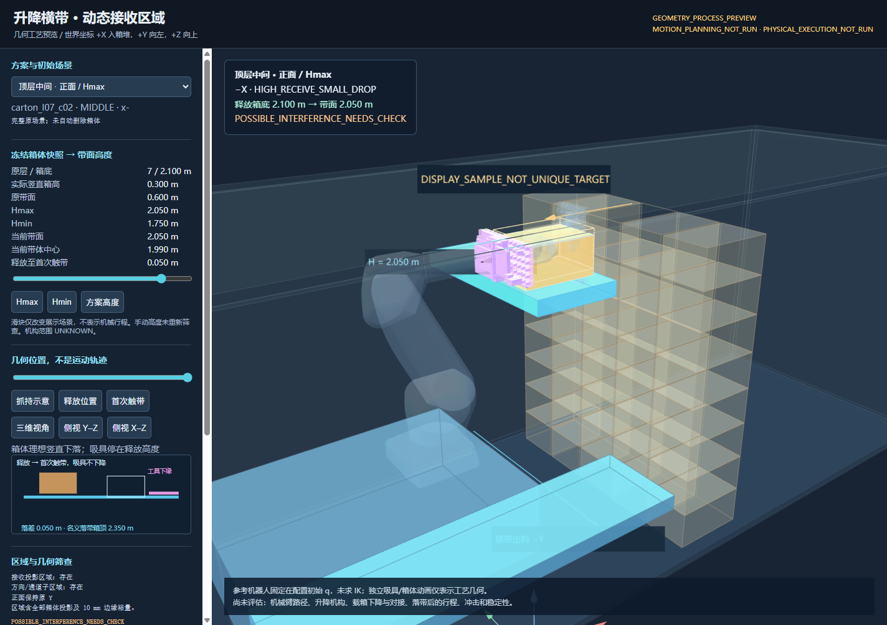
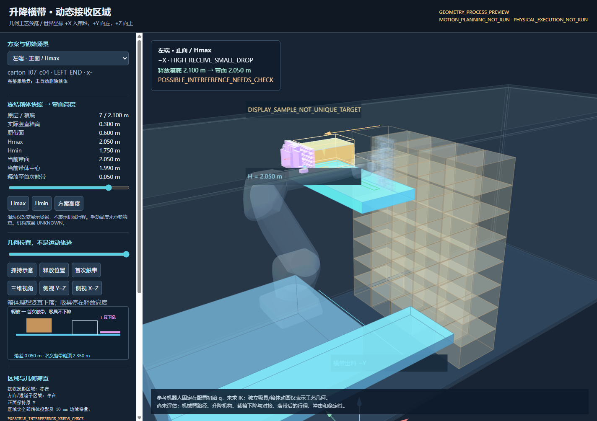
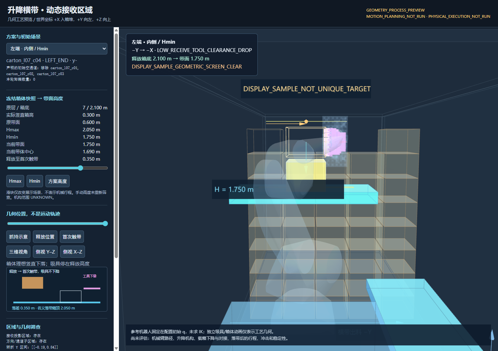
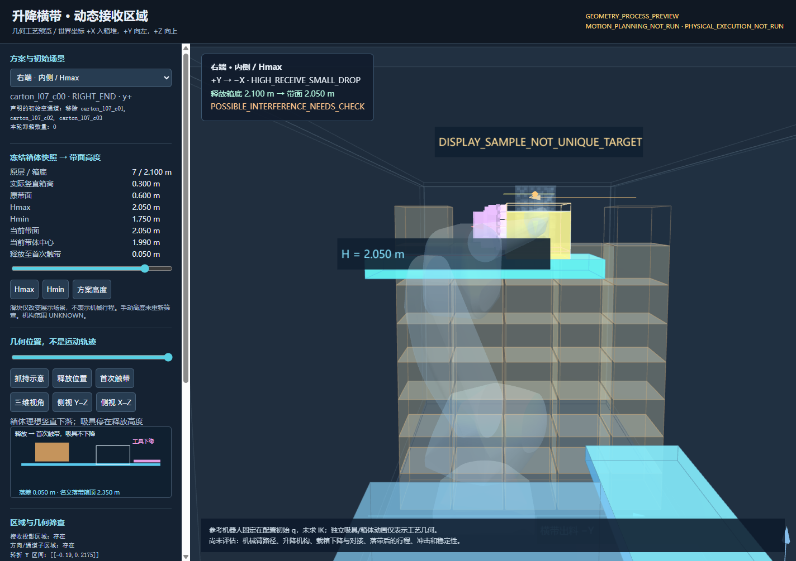

# 升降横带与动态接收区域：几何预览（2026-10-17）

本轮完成独立横带高度状态、动态完整投影接收区域和离线三维预览。**没有运行 IK、RRT、LIN、原生 worker、Isaac 或物理释放；以下均不是卸箱完成或执行资格结论。**

[下载离线 ZIP](experiments/m710_lifted_reception_20261017/offline-preview.zip)（解压后直接打开 `preview.html`，无需网络/ROS） · [机器可读汇总](experiments/m710_lifted_reception_20261017/summary.json) · [完整几何结果](experiments/m710_lifted_reception_20261017/geometry.json)

## 实现与边界

实测源码 **`66f18208a86d291ff6895ca3f0e3b461ad2b7b62`**：核心代码提交 `e49f141`，随后 `66f1820` 只补充页面中保守排除区域的红色显示，再生成最终结果。交付提交是该源码的报告/证据后继提交；完整交付 SHA 和推送核验见交付回复。所有文件采用 UTF-8；源码、结果分别保留自己的 SHA，报告提交不是另一套算法。

`lifted_reception.py` 从既有 assembly 变换构建场景，只平移唯一 `conveyor_transverse`。默认仍为旧 0.600 m 带面；纵带、底盘和机器人不动。渲染与 native `box_message` 格式均来自同一 OBB 集合；高度进入新场景指纹，**没有发送 native world 请求**。带体厚度 0.120 m，Hmax/Hmin 对应中心高度为 1.990/1.690 m。真实机械行程 `UNKNOWN`，升降机构 `NOT_MODELED`；负高度或已知超行程会保留原值并报问题，不 clamp。

任务初态快照按实际 OBB 竖直投影计算 `h` 和 `z_b`，移动后不追算。当前顶层 `h=0.300 m, z_b=2.100 m`，因此 **Hmax=2.050 m、Hmin=1.750 m**，名义落差分别 **0.050/0.350 m**。Hmin 首次触带箱顶为 2.050 m；本次侧抓工具下缘约 2.106 m，竖直关系余量约 **0.056 m**。这里只是高度关系，工具在释放后保持原高度。

横带单独覆盖完整八角点水平投影，边缘裕量 0.010 m，不借纵带面积补足。顶层标准箱中心接收区域为世界 **X∈[-0.590,-0.510] m、Y∈[-0.190,0.890] m**。输出保留区域；页面位置明确标为 `DISPLAY_SAMPLE_NOT_UNIQUE_TARGET`。一般旋转箱体按真实投影计算；非世界轴对齐的方向模板会明确报不适用。姿态保持是空间朝向约束，不锁定腕关节数值。

## 实际几何结果

左右/层角色由原始几何层与 Y 排序确定。两侧内抓案例声明移除顶层中间三箱 `carton_l07_c01/c02/c03`，保留两端及所有低层箱体；这是测试初始条件，**本轮卸箱数量为 0**。

| 方案 | 实际箱体/物理面 | 方向及带高 | 接收方向子区域 | 几何结论 |
|---|---|---|---|---|
| 顶层中间正面 | l07_c02 / x− | −X，Hmax | X [-0.590,-0.510]，Y=0 | 抽离/下落筛查无提示；初态参考吸具与升高横带有潜在干涉 |
| 左端正面 | l07_c04 / x− | −X，Hmax | 同 X，Y=0.840 | 同上；保留 `POSSIBLE_INTERFERENCE` |
| 左端内侧 | l07_c04 / y− | −Y→−X，Hmin | 转折 Y 约 [-0.190,0.840) | 展示样本保守几何筛查无干涉提示；不是可执行证明 |
| 右端内侧 | l07_c00 / y+ | +Y→−X，Hmax | 转折 Y 约 [-0.190,0.2175] | 抽离/下落筛查无提示；初态参考吸具与横带有潜在干涉 |
| 未清空通道反例 | l07_c04 / y− | −Y→−X，Hmin | 无通过保守通道筛查的子区域 | 只否定当前模板；障碍物保留 |
| 较低层 | l06_c02 / x− | −X，带面1.750 | 存在 | 上方 l07_c02 保留，抽离包络提示潜在干涉 |
| 非默认箱高 | 顶层中间，h=0.400 | −X，Hmax=2.050 | 存在 | Hmin=1.650，低模式名义落差0.450；当前 Hmax 初态吸具提示仍保留 |

Hmax 三个主案例的初态筛查共各报 **35 个工具实体—横带对象对**（202 个完整工具实体均保留）。它们是源工具 OBB/保守包络结论，不包装成原始 CAD 的精确穿透。当前机器人 q 固定显示，未生成或宣称机械臂全路径避碰。中间箱正面展示抽离长度 **0.850 m**，已超过旧入口 0.800 m 抽离上限；没有截短接收区，也没有修改旧规划器。

中途仅保留现有 `planner_relaxed_physics_checked` 工艺中具名、同平面、水平运动、零穿透的支撑接触；最终仍要求 5.2 mm 分离。正常外部净空仍为 5 mm。柔性杯邻箱规则、当前名义压缩几何与完整密封环几何沿用既有能力；下落中只保留有界的具名初始杯接触，刚性嵌件/新挂碰不豁免。保守扫掠提示意味着需进一步核查，不是连续机器人路径证明。

## 验证、复现及未迁移项

Linux 既有隔离环境：Python 3.10、现有模型与依赖；没有升级或重编原生 worker。CPU 亲和性 0–21，OMP/OPENBLAS 各 1 线程。**85 项定向测试通过**（本轮 22 项，原 contact/extraction 相关 63 项），`py_compile` 通过；[日志](experiments/m710_lifted_reception_20261017/tests.log)。[浏览器检查](experiments/m710_lifted_reception_20261017/browser-checks.json)覆盖四方案、唯一横带、world/画面高度一致、手动高度身份变化、纵带不动、低模式工具固定、空通道反例和零网络资源请求。

在既有 chroot `/work-single-contact-20261016` 的实际命令：

```bash
export OMP_NUM_THREADS=1 OPENBLAS_NUM_THREADS=1 PYTHONPATH=src
/opt/planning-opt-20261003-venv/bin/python -m pytest -q \
  tests/test_lifted_reception.py tests/test_single_contact.py tests/test_single_extraction.py
taskset -c 0-21 /opt/planning-opt-20261003-venv/bin/python \
  tools/preview_m710_lifted_reception.py \
  --source-commit 66f18208a86d291ff6895ca3f0e3b461ad2b7b62 \
  --output /tmp/lift-reception-20261017/delivery
```

复现应使用新的输出目录。原始开发目录、首次缺少 chroot 内 git 命令的生成失败日志及改为显式源码身份后的记录均在本轮独立服务器目录保留；最终结果没有读取旧成功路径/q/mask。几何生成耗时只记在 JSON，**不当作轨迹规划耗时**。

原 `contact-only`、`through-extraction`、`through-preplace` 均未迁移；`fixed_preplace_target()` 的固定纵带中心仍是历史入口，新模块不调用它。旧 `release_motion` 的 5 cm 执行模型没有放宽。新模块尚未接机器人轨迹、place/release/withdrawal。载箱下降/纵带对接、落带后的运行距离、冲击/回弹/倾倒/稳定/承载均 `DEFERRED_BY_SCOPE`，没有用于拒绝本轮几何，也没有填 PASS。

全部结果为 **GEOMETRY_PROCESS_PREVIEW / MOTION_PLANNING_NOT_RUN / PHYSICAL_EXECUTION_NOT_RUN**；`qualification_status=NOT_EVALUATED`，`continuous_swept_proof=false`。未运行五箱/40箱任务、Isaac、真机、preflight、执行包或重型资格验收。

## 四类实际浏览器截图





