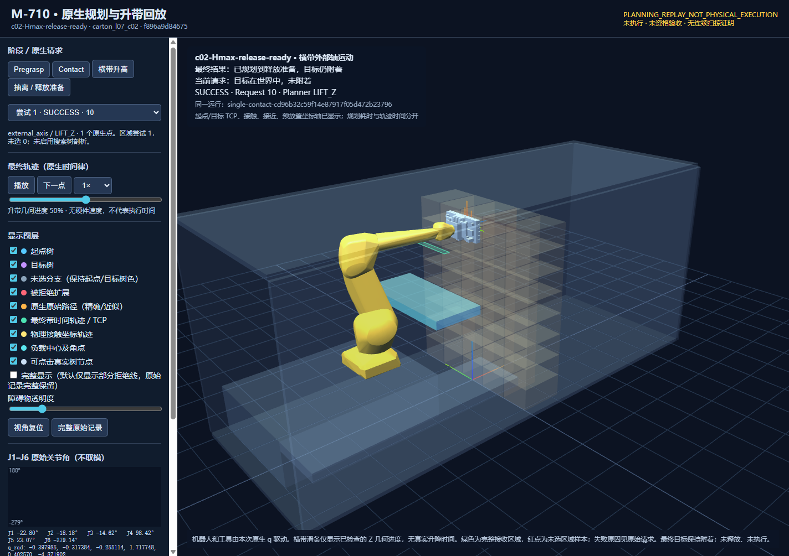
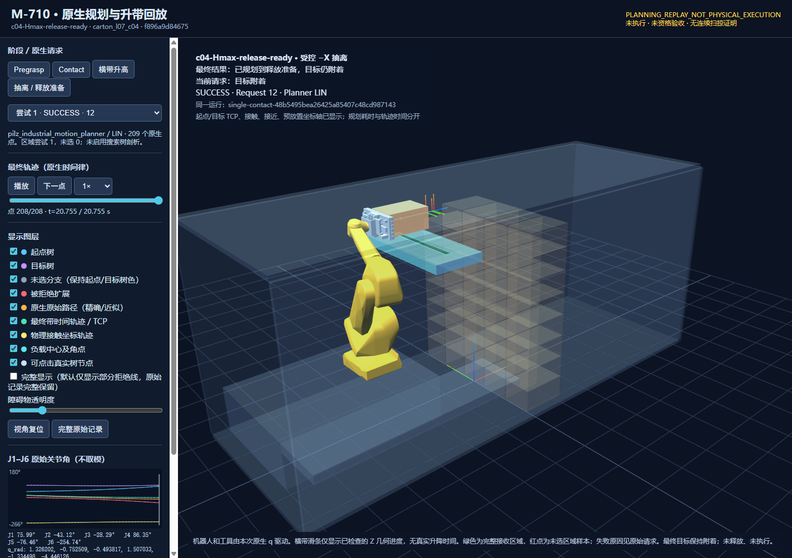

# 正抓＋Hmax 横带：原生释放准备规划（2026-10-17）

最终版本 c02、c04 均完成 **pregrasp → 受检查升带 → contact → 规划附着 → −X LIN 抽离**，目标仍 attached；没有释放或物理执行。两例从各自明确的**配置静止初态、完整 40 箱场景**重新规划，不是上一箱撤离反馈。没有先验或历史解输入。

状态：`LIFTED_RECEIVER_RELEASE_READY_PLANNED_NOT_EXECUTABLE`；`qualification_status=NOT_EVALUATED`；`continuous_swept_proof=false`；`physical_execution=NOT_RUN`。

| 案例 | 到释放准备 | 总规划(s) | 初始化(s) | 所选面 / 前缀尝试 | 区域样本 | IK / OMPL / LIN / PTP |
|---|---|---:|---:|---|---|---|
| 中间 c02 | 是，仍附着 | **4.390408** | 1.688416 | 正面 / 1 | 首个通过 | 1 / 1 / 2 / 0 |
| 左端 c04 | 是，仍附着 | **5.450982** | 1.707861 | 正面 / 1 | 首个通过 | 1 / 1 / 2 / 0 |

每例另有 1 次外部轴规划请求，先验调用 0。这是实际调用数，不是业务次数限制；IK API 内部恢复次数不可观察。没有增加一次 IK、一次 RRT、单一区域中点限制。小样本不证明成功率不退化或稳定性能改善。

## 初态干涉、同步与场景更新

真实 RobotModel、完整工具和原生 Clearance 检查在**相同配置 q**下给出：低位横带 `SUCCESS`；Hmax `RECEIVER_STATE_REJECTED`，首个对象对为 `tool_compliant_bellows_0 / conveyor_transverse`，规则 `INTERSECTION_OR_CONTACT`，正常要求 5 mm。FCL 的 `surface_distance_m=-1` 是查询哨兵值，不是 1 m 穿透深度。它确认存在真实干涉，并未证明此前 35 个保守告警对全部碰撞，也未证明 Hmax 不可用。

两例均选择**本次 OMPL 接近轨迹的实际末态**停臂升带，未使用固定安全点。横带中心 Z 从 0.54 到 1.99 m，顶面从 0.60 到 2.05 m；其纯 Z 平移的精确几何并集用于全行程检查，机器人 q 不变。原生检查覆盖当前 RobotModel、完整工具、目标及其他已知世界几何；本次同步时尚未附着。

冻结布局已声明横带与 chassis、纵带的装配接触。升带检查没有给它们新增碰撞豁免：仅对这两个既有具名关系证明水平分离平面保持、无内部穿透，再检查 Hmax 终点恢复 5 mm；未知对象或穿透仍拒绝。每次升带有 49 次世界 box FCL 查询（包含 2 次终点查询），机器人/工具查询另外记录在 `sweep_clearance`，没有把两者混计。

外部轴以独立 MTC 阶段保存旧/新场景身份，父链为 **pregrasp → external_axis → contact → extraction**。原来的父场景比较未关闭；只允许已绑定横带沿 Z 改变，其他 world、q、目标身份和几何保持原样。升带后重新建立检查上下文。模型/只读资产可复用，旧场景判定不继承。

## 接收终点与附着

区域由当前横带与完整箱底投影计算，原始箱中心 X 区间为 **[−0.59, −0.51] m**，Y 保持该箱原值。保守占用筛查保留原区域与待核查部分，不等同机器人不可达。正常采样先试近边界内缩两倍既有 FK 位置容差，再试远端及区间细分；某样本失败不会否定整个区域。范围与恢复受共享任务/阶段期限约束。

本次两例都选中 **X=−0.5102 m**，抽离 **0.8102 m**，不是展示中点 −0.55 m；旧 `maximum_extraction_m=0.8` 属于旧入口的搜索范围，没有被冒充机械极限，也没有全局修改。没有额外 transit，没有固定纵带目标。

| 实际返回末态 | c02 | c04 |
|---|---:|---:|
| 箱中心 X(m) | −0.5101999944 | −0.5101999968 |
| 箱中心 Y(m) | 0.0000000219 | 0.8399999798 |
| 箱中心 Z(m) | 2.2499999998 | 2.2499999805 |
| 箱底到横带顶面(m) | 0.0499999962 | 0.0499998913 |
| 姿态矩阵最大分量误差 | 1.68e−8 | 3.42e−7 |

附着来自本次 contact 实际末 q 的 FK、目标实际规划位姿及通过的终端杯几何结果，world→attached 唯一转换，未改写末样本。抽离为固定空间朝向的 Pilz LIN；保留具名初始支撑/邻箱规则、返回轨迹已有采样点的 FK/负载分离检查，以及终点恢复自由空间规则的原生检查。完整箱底进入接收区域、名义 5 cm 间隔均由实际末态核对。没有宣称连续扫掠工艺证明或吸附承载资格。

## 耗时与计时层级

下表均为秒。初始化单列，场景准备 0.013396 / 0.013393 s 包含在初始化中。总规划包括本次所有目标生成、失败尝试、请求、检查和返回处理；不含离线查看器/报告生成。**行、请求往返、原生检查是嵌套区间，不可相加。**

| 边界 | c02 | c04 |
|---|---:|---:|
| 目标生成及低位/Hmax 初态检查 | 0.208674 | 0.208727 |
| 显式接近 IK（上层） | 0.044043 | 0.047101 |
| pregrasp（上层） | 1.109236 | 2.110460 |
| 升带请求（上层） | 0.181984 | 0.158934 |
| └ 其中实际请求往返 | 0.172200 | 0.149257 |
| └ 其中原生升带几何检查 | **0.016825** | **0.016538** |
| contact（上层） | 0.270371 | 0.258616 |
| 终端接触几何检查 | 0.009023 | 0.009164 |
| 附着上下文 | 0.008631 | 0.007862 |
| extraction（含目标生成约 0.00114 s） | 0.630211 | 0.643962 |
| 已返回抽离采样的 FK/负载位姿核查 | **1.512209** | **1.526209** |
| 原生终点分离/自由空间检查（上层） | 0.081280 | 0.120353 |
| 实际末态接收区域检查 | 0.000428 | 0.000527 |
| **总规划** | **4.390408** | **5.450982** |

c02 主要已测成本是已有返回采样核查；c04 为接近请求，其次返回采样核查。本轮未追加优化。原生机械臂轨迹时间律合计约 31.390 / 31.214 s，与规划墙钟不同；横带没有真实速度/加速度参数，其执行时长为 null，不能报告完整作业周期。

## 测试、失败保留与版本

- Python 148 项受影响定向回归通过；随后序列化修补重跑 28 项子集通过，不能相加成 176 项独立测试。覆盖旧入口、预算恢复、区域首样本拒绝继续、场景/父链及末态检查。
- Release 原生 `m710_lifted_receiver_test` 通过，断言未被 NDEBUG 关闭：精确 Z 并集发现起终点均安全但中段碰撞、受控世界变化、具名装配分离与未知对象/1 mm 穿透拒绝。
- 每例浏览器 15 项实际回放核对通过，包括真实 q、升带中点 q 恒定、场景唯一、接触/抽离连续与末态负载 FK；浏览器与 Python 的负载矩阵最大差为 8.9e−16。
- 首版 `8427071` 的 c02/c04 因将既有装配接触机械套用普通世界间隙而失败，分别耗时 **90.207 / 90.313 s**，完整保留。修补仅恢复冻结布局已声明关系的分离语义。
- `6137554` 的 c02 原生各段通过，但 NumPy bool 导致结果 JSON 写出失败，没有完整 result，也不补造总耗时。修正 JSON 标量后冻结 `f896a9d`，重新运行受影响案例；未改变 seed、目标、预算或净空来挑选成绩。

基线 `49766dfd3972e0f803c595612601e83fccde5e9e`；**最终实测源码 `f896a9d84675125678dd32208de1183b2fb8dadb`**。最终交付中的后续差异仅为汇总压缩重复静态 policy、回放显示和报告归档；没有把补修前成绩重标为新代码成绩。两个运行 ID：

- c02：`single-contact-cd96b32c59f14e87917f05d472b23796`
- c04：`single-contact-48b5495bea26425a85407c48cd987143`

worker SHA256：`cf6c18ba575b55a011eebf470b169d51d499e3575d3a38410b09d23712f41364`。原生部分在 `6137554` 构建，至 `f896a9d` 无原生源码差异。环境原始记录早于重构建，其中旧 worker 散列仅对应首版；最终身份以 [identity.json](experiments/m710_lifted_release_ready_20261017/identity.json)、[worker.sha256](experiments/m710_lifted_release_ready_20261017/worker.sha256) 及每次 result 为准。

环境固定：Xeon Platinum 8352V、CPU 0–21、OMP/OPENBLAS=1、Release、Ubuntu 22.04.5 / ROS Humble；MoveIt 2.5.10、MTC 0.1.3、FCL 0.7.0、KDL 1.5.1、OMPL 1.7.0。未升级依赖。任务 300 s / 阶段 90 s / IPC 100 s，seed 71070，实际响应保持 `pair_profile_enabled=false`、未测对象对耗时 null；ProcessSealInput、输入预解析及两类固定关系复用保留。

既有隔离环境内的实际入口（两案各自输出目录；完整包装见 [run-final.sh](experiments/m710_lifted_release_ready_20261017/run-final.sh)）：

```bash
source /opt/ros/humble/setup.bash
cd /work-single-contact-20261016
export PYTHONPATH=src PYTHONNOUSERSITE=1 OMP_NUM_THREADS=1 OPENBLAS_NUM_THREADS=1
export M710_MOVEIT_ASSET_ROOT=$PWD
taskset -c 0-21 /opt/planning-opt-20261003-venv/bin/python tools/plan_m710_approach_contact.py \
  --through-lifted-release-ready --target carton_l07_c02 --seed 71070 \
  --task-budget-s 300 --stage-budget-s 90 --ipc-timeout-s 100 \
  --worker-command /tmp/lift-native-20261017/worker.sh \
  --worker-binary /tmp/lift-native-20261017/build/m710_moveit_worker \
  --source-commit f896a9d84675125678dd32208de1183b2fb8dadb \
  --output /tmp/lift-native-20261017/c02-final
# c04 使用 carton_l07_c04、c04-final，其余相同。
```

## 回放与剩余边界

[下载离线回放 ZIP](experiments/m710_lifted_release_ready_20261017/offline-viewers.zip)：解压打开 c02 / c04 HTML。原查看器复用官方机器人与实际 q，展示低位初态、同步状态、横带升高、接触/附着/抽离及完整接收区域；升带滑块为几何进度，不伪造执行秒数。最终两案没有未选样本，面板如实显示 0；失败情况下已有样本及原因可查看。ZIP 同时保留原几何预览的修正版副本，只修复红色图例问号，旧证据未覆盖。




[机器汇总](experiments/m710_lifted_release_ready_20261017/summary.json) · [逐案 CSV](experiments/m710_lifted_release_ready_20261017/timing.csv) · [全部必要原始记录（含失败）](experiments/m710_lifted_release_ready_20261017/raw-records.zip) · [原始逐文件散列](experiments/m710_lifted_release_ready_20261017/raw-identities.json)。归档 37 个原始文件已逐一核对 SHA256；没有执行包或伪造取放视频。

未知升降机构几何、机械行程、真实升降速度/加速度仍未评估，本次只覆盖已知横带碰撞体，不能宣称完整机构资格。侧抓两段抽离、Hmin 落箱、真实释放、载箱降带、横纵带对接、右侧出料距离、冲击/回弹/稳定/承载均暂缓，既不误拒绝也不标 PASS。旧 contact/extraction/preplace 兼容，旧完整取放入口未迁移到升降横带；未运行 Isaac、真机、preflight、执行导出、五箱/40 箱任务、全量 pytest 或重型资格验收。本轮到此停止。
