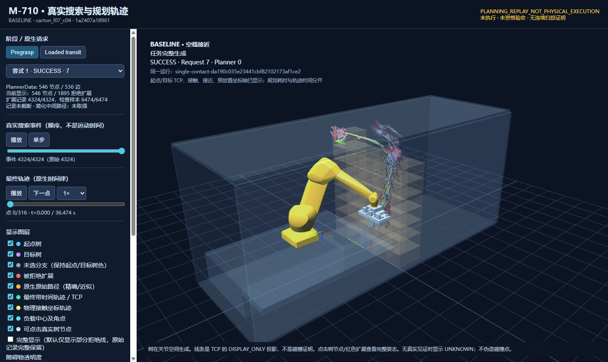
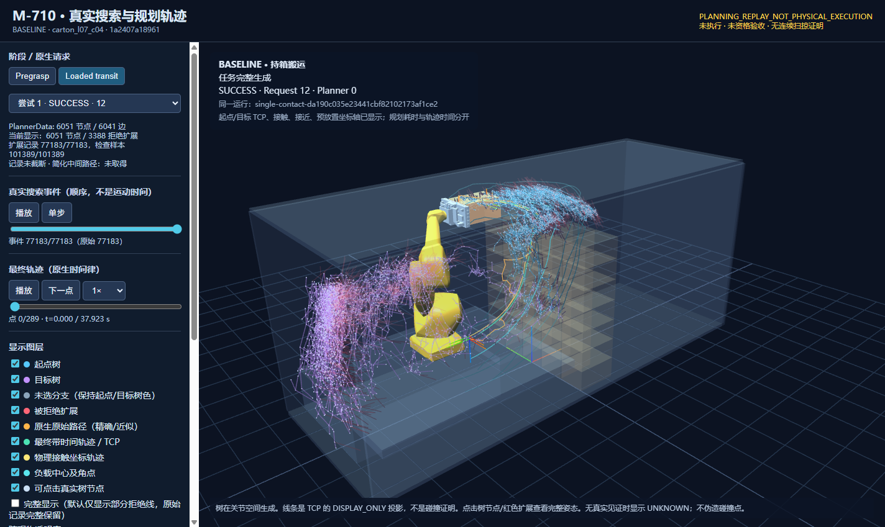

# c04 真实搜索回放与固定目标预算恢复（2026-10-17）

已交付可在 Windows 直接打开的[离线查看器 ZIP](experiments/m710_search_replay_20261017/c04-offline-viewers.zip)、[实际回放 MP4](experiments/m710_search_replay_20261017/c04-planning-replay.mp4)及两个版本的原始记录。算法性能改进**未通过**：正常模式 c04 变慢，c02 小幅变快；小样本未证明成功率不退化。




## 版本和结果

起始基线 `a76025c2b879ee20c4cfb5d38892c45f40e84091`。未改变规划策略的有效实测源码为 `1a2407a18961aa2729bdc96dc2dd1a7c27402acd`；独立恢复控制提交/新版实测源码为 `94681a93aad8809c9735dc90d3164c41aeb2ab84`。后续只整理查看器、测试和报告，没有改规划代码。所有源码和报告为 UTF-8；源码冻结提交与交付提交用途不同。

| 模式 | c04 完整 | c04 总规划(s) | c02 完整 | c02 总规划(s) |
|---|---|---:|---|---:|
|基线，记录关闭|True|51.585|True|9.676|
|新版，记录关闭|True|61.717|True|9.142|

| 无记录请求往返(s)，包含原生工作 | 基线 c04 | 新版 c04 | 基线 c02 | 新版 c02 |
|---|---:|---:|---:|---:|
| pregrasp |9.171|14.611|0.885|1.133|
| transit |39.288|43.855|5.695|4.673|

四个正常样本都在正面完成到仍附着的 preplace，分别实际调用 IK 2 / OMPL 2 / LIN 2 / PTP 0，先验调用 0。正常模式搜索记录默认关闭；逐对象对计时仍关闭、细项为 null，ProcessSealInput、输入预解析和两类固定关系复用保留。时间包含失败尝试和既有返回检查，初始化约 1.66–1.75 s、场景准备约 0.013 s 单列。请求时间包含原生求解/检查，不能与任务总时间再次累加。

基线 c04 记录模式 **94.188 s，完成**；新版 c04 记录模式 **296.110 s，未完成**。新版正面 pregrasp 14.153 s、transit 91.081 s（阶段内部含 IK/处理的口径另见 JSON），transit 请求原生 SUCCESS，但返回超过连接共享 90 s，未接受、更未执行。顶面 429 次本地恢复未完成，侧面 y- 无合法几何抽离长度，y+ 的 413 次恢复未完成；累计 IK 845 / OMPL 3 / LIN 3。所有失败计入总成本。该记录同时说明当前宽松恢复流程可能在困难目标上消耗大量预算，不能宣传为已验证的性能优化。

记录模式不是正常性能成绩。诊断缓冲、JSON 输出、运行时和 KDL 私有随机初始化均可能影响墙钟和有时限搜索结果；本轮没有隔离出完整任务上的纯观测开销，不把两个全任务时间差全部归因于记录。没有追加成功重跑或挑最快样本，也没有估算五箱成绩。

## 实施与边界

保留单一接触/接近/预放置业务目标、原面序、LIN 工艺、5 mm 净空和全部身份限制。原先的 `max_ompl_attempts=1`、单 IK 失败立即弃面等限制，仅在显式 `--legacy-single-attempts` 诊断模式保留。正常新链路由共享连接阶段/任务预算和失败类型控制；每次 IPC 内一条运动请求不再等于整个目标只允许一次。当前初值优先，用 KDL 有正时限的 `searchPositionIK` 和同连接局部排除取得其他数值构型；不增加业务目标或 Python 种子池。插件内部尝试次数不可观察，记录 null。

本接口没有可合法保留的跨请求树，故明确记录 `IK_RECOVERY_THEN_RRT_RESTART`、`tree_retained=false`。上下文摘要绑定实际起点、目标、世界、父 receipt 和附着；取消、非法起点和身份变化停止，未完成不变成全局不可达。首次合格结果立即返回。各面共享 300 s 任务期限，连接阶段 90 s，IPC 100 s；数值调用使用原 0.10 s 上限与剩余期限的较小者，无次数小上限。

原生 OMPL 1.7.0 / MoveIt 2.5.10 的项目内诊断适配保留原 `growTree/solve` 算法，实际 PlannerData 在 clear 前快照，扩展事件来自真正 RRTConnect，失败见证只取同一次既有 Clearance/ProcessPolicy 检查。没有重放碰撞计算、最近邻猜父节点或扰动最终路径。普通 MoveIt 拒绝无对应见证则 UNKNOWN。诊断默认关闭；上限只截断记录，不停止规划。来源与许可证见 [SEARCH_TRACE_SOURCES](../ros2/m710_moveit_backend/src/SEARCH_TRACE_SOURCES.md)。

基线 pregrasp 546 节点 / 4324 扩展，transit 6051 节点 / 77183 扩展（71143 拒绝）；均未截断。分支、原始解、最终时间轨迹分层。简化/平滑中间版本未由接口提供，标为缺失；不从最终路径推算。原 PlannerData 部分 GOAL 根标记缺失，保留原标记及原边；结构核查确认无父 GOAL 顶点位于当前目标（误差 <1e-10），未补造边。

查看器包含完整碰撞模型、world/attached 唯一目标、接触/接近/预放置坐标系、节点/失败扩展姿态、未取模 J1–J6、各阶段/尝试和 IK 失败记录。线条是 TCP 的 DISPLAY_ONLY 投影；实际检查样本另以点显示，未记录的检查边界/接触点不伪造。新版正面超时后的原生路径显示为候选，页面明确“任务未完成”。视频来自同一 BASELINE 运行，搜索事件步进与 2x 预计运动时间分开，非 Isaac 录像。

## 验证、保留失败和复现

144 项规划/协议定向 Python 测试及 10 项导出结构测试通过；原生预算/作用域测试通过。原生 RRTConnect 记录关闭/开启/限额三组均为 **868 次检查、相同检查顺序与 25 点路径**，限额不停止求解。真实 KDL 接口探针从归档实际初态开始，首次与排除首次结果后的第二次均返回不同合法 q，API 时间 0.000340 / 0.000760 s；不把探针输出带入正式任务。Windows 浏览器核验 FK 最大差异 2.22e-16、附着差异 5.55e-16，回放不改原数据，目标不重复留在 world。

开发失败保留：首次 ROS shell 配置和插件安装元数据错误未进入规划；早期替换 MoveIt 具体 StateValidityChecker 的包装不兼容，152.767 s 后停止该自有诊断进程，修正为原 feasibility 回调旁路记录，未改系统库。一次接口探针误用 1e-6 FK 阈值而非项目 1e-4 m / 2e-4 rad，被正常拒绝；原记录保留，改正探针输入后核验。正式记录模式 SSH 中断后重连，原任务未重启。详见 development-failures 和 probe 原始记录。

环境仍为原授权 Xeon Platinum 8352V，CPU 0–21，OMP/OPENBLAS=1，Release -O3 -DNDEBUG，Ubuntu 22.04.5，MoveIt/Pilz 2.5.10、MTC 0.1.3、FCL 0.7、KDL 1.5.1、ROS Humble OMPL 1.7.0；未升级。模型/worker/输入摘要、每例原命令、全部计数和时间在 [summary.json](experiments/m710_search_replay_20261017/summary.json)、[timing.csv](experiments/m710_search_replay_20261017/timing.csv)、freeze 文件及 run-*.sh。c04 输入仅恢复初始 q 和移除箱体，不导入旧成功末态或轨迹。

```bash
source /opt/ros/humble/setup.bash
cd /work-single-contact-20261016
export PYTHONPATH=src OMP_NUM_THREADS=1 OPENBLAS_NUM_THREADS=1 PYTHONNOUSERSITE=1
export M710_MOVEIT_ASSET_ROOT=$PWD
taskset -c 0-21 /opt/planning-opt-20261003-venv/bin/python tools/plan_m710_approach_contact.py \
  --through-preplace --search-trace --target carton_l07_c04 \
  --initial-state /tmp/preplace-ik-20261017/c04-input.json --seed 71070 \
  --task-budget-s 300 --stage-budget-s 90 --ipc-timeout-s 100 \
  --worker-command /tmp/search-trace-20261017/worker.sh \
  --worker-binary /tmp/search-trace-20261017/build/m710_moveit_worker \
  --source-commit 94681a93aad8809c9735dc90d3164c41aeb2ab84 --output NEW_UNUSED_DIRECTORY
```

不传 `--search-trace` 为正常模式；c02 使用完整 40 箱配置初态，不传 c04 输入。查看器由 `tools/export_m710_search_replay.py RUN --label LABEL --output VIEW.html` 离线导出。没有运行 place/release/withdrawal、等价角优化、先验、五箱/40箱任务、Isaac、真机或重型执行验收。本轮到此停止。

所有回放：**PLANNING_REPLAY_NOT_PHYSICAL_EXECUTION**；qualification_status=NOT_EVALUATED；continuous_swept_proof=false；physical_execution=NOT_RUN。
